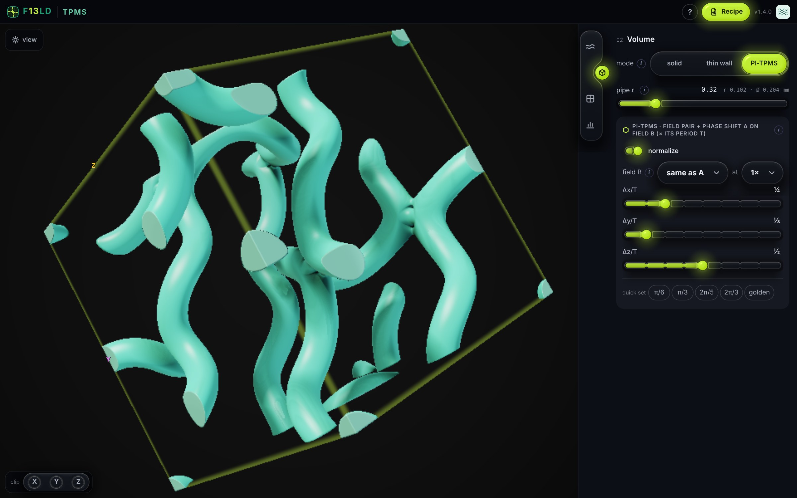
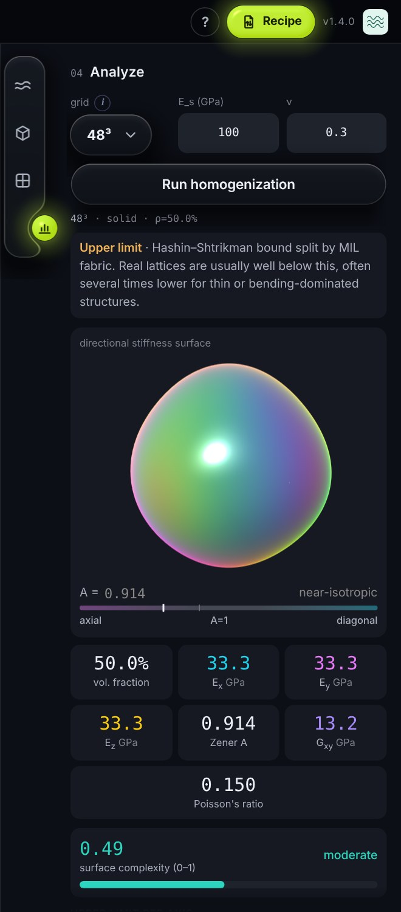
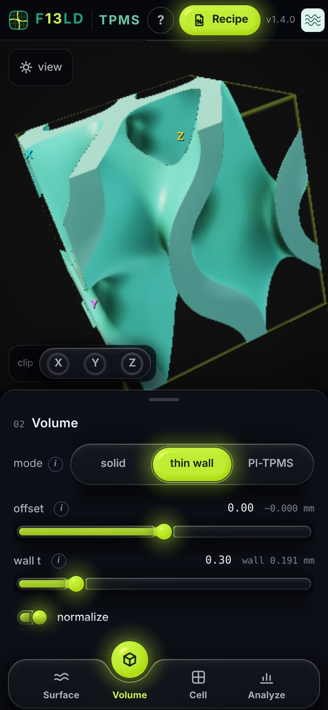

# F13LD.tpms

Design triply periodic minimal surface (TPMS) lattices from their implicit equations, see them in real time, estimate their stiffness, and hand them off to meshing and simulation. Part of the [F13LD](https://f13ld.app) suite.

**[Launch the tool](https://mshomper.github.io/f13ld.tpms)**. Runs in the browser: no install, no login.

## Workflow

Pick a surface, give it volume, set the cell, analyze. The controls follow that order in four sections: a rail on desktop, a tab bar in a bottom sheet on phones.

### Surface
- **13 presets:** gyroid, Schwarz P, Schwarz D, Neovius, I-WP, split-P, F-RD, Fischer-Koch S, gyroid-harmonic, primitive-C (G6), octo (G8) and P-harmonic (cubic symmetry), plus lidinoid (threefold symmetry).
- **Equation editor:** the surface is `F(x,y,z) = Σ cᵢ · ∏ trig(fx·x, fy·y, fz·z) = 0`.
  - Each term has a coefficient and one or more sin/cos factors with their own x/y/z frequencies.
  - Terms show as one line each; tap one to edit it, and switch terms on or off without deleting them.
  - The equation bar updates live.

### Volume
- **Solid:** the region on one side of the level set; **offset** sets the volume fraction.
- **Thin wall:** a shell `|F − offset| < t`. **Normalize** divides by |∇F| so the wall thickness is a true perpendicular distance.
- **PI-TPMS:** cylindrical pipes of radius **r** along the intersection of field A and a phase-shifted field B.
  - **Field B:** a copy of A, any preset or custom terms, run at 1–5× A's frequency.
  - **Phase shifts Δx, Δy, Δz:** fractions of B's period. The sliders settle onto eighths of a period when released close to one; type any value in between.
  - **Quick set:** π/6, π/3, 2π/5, 2π/3 and golden.
  - **Normalize:** gives truly round pipes.

### Cell
- **Cells:** 0.5–3× unit cells in the view. Analysis and export always use one cell.
- **Cell size (mm):** a display-only physical scale for the mm read-outs (wall, pipe diameter, cell edge and volume). It is saved with the recipe.

### Analyze

**Homogenization** on a voxelized unit cell (32³, 48³ or 64³), with the solid's Young's modulus and Poisson's ratio as inputs. Rerun whenever the design changes; the Analyze tab marks results as out of date.

- **Solid and thin wall: an upper limit.** A Hashin–Shtrikman upper bound for a porous solid, split across the axes by the mean-intercept-length (MIL) fabric tensor. Real lattices are usually well below it, often several times lower for thin or bending-dominated structures.
- **PI-TPMS: a data-trained estimate.** A regression fitted to the [Vixiv](https://vixiv.net) homogenization dataset (PI-gyroid and PI-Fischer-Koch S, round pipes, r = 0.16–1.41). Its typical error is ×1.8 for E and ×1.2 for G. The results show the uncertainty as a spread for each modulus. Pairs other than self-pairs fall outside the training data.
- **Outputs:**
  - volume fraction;
  - Ex, Ey, Ez, Gxy (plus Gxz and Gyz for PI-TPMS);
  - Poisson's ratio;
  - Zener anisotropy ratio;
  - a 3D directional-stiffness surface;
  - surface complexity (solid and thin wall).
- **Rigorous FFT homogenization:** F13LD.lab.

 

## Viewer

- **Rendering:** a WebGL2 ray-marched preview. Drag to orbit, scroll or pinch to zoom.
- **Adaptive quality:** while you orbit or drag a control, the preview renders at reduced resolution; it sharpens once you stop.
- **Clip planes:** tap X, Y or Z to clip that axis, drag the handle to slide the plane, tap the axis again to remove it.
- **View menu:** shadows, occlusion, warm/cool light, shaded cut faces and lime edges.

## Recipes

The **Recipe** menu in the header:

- **Open recipe…** loads a recipe JSON exported from F13LD.tpms. You can also drop a `.json` anywhere on the tool or paste recipe JSON. Undo appears in the confirmation.
  - Older recipes (1.0) load.
  - Out-of-range values are clamped, with a note.
  - Recipes from other F13LD tools are recognised and refused with a pointer to the right tool.
  - Analysis results are not restored; rerun them.
- **Export JSON** downloads the current recipe.
- **Queue** adds it to F13LD.queue.
- **Mesh** opens it in F13LD.mesh (a watertight, printable 3MF).
- **Lab** opens it in F13LD.lab (FFT homogenization).

Recipe format (version 1.1.0):

| Key | Contents |
|---|---|
| `meta` | `version`, `tool` (`f13ld.tpms`), `timestamp`, `preset` |
| `surface` | `{type: "terms", preset, terms[]}` or `{type: "raw_preset", preset, label}` |
| `surface_b` | field B for PI-TPMS (same shape as `surface`), `null` when B is a copy of A |
| `geometry` | `mode`, `offset`, `cell_scale`, `wall_thickness`, `shell_normalize`, `pipe_radius`, `pi_normalize`, `phase_shift`, `field_b_freq`, `field_b_scale` |
| `display` | `cell_size_mm` (display only) |
| `homogenization` | present after a run: inputs, moduli, method |

 

## Technical

- **One self-contained `index.html`;** no build step. It is hosted on GitHub Pages.
- **Shader:** settings you drag are passed to the shader as uniforms, and it recompiles only when the surface's structure changes (preset, terms, mode). Interactive frames render at an adaptive scale; the full-resolution frame renders in strips when you stop.
- **Controls:** built on the liquid-ui kit (signed-distance shapes, springs). They fall back to plain native controls without WebGL.
- **Data:** stays in your browser unless you send it to Queue, Mesh or Lab.
- **Version:** v1.4.0.

## References

Harrigan, T.P. & Mann, R.W. (1984). Characterization of microstructural anisotropy in orthotropic materials using a second rank tensor. *Journal of Materials Science*, 19, 761–767.

Hashin, Z. & Shtrikman, S. (1963). A variational approach to the theory of the elastic behaviour of multiphase materials. *Journal of the Mechanics and Physics of Solids*, 11(2), 127–140.

Jones, A., Leary, M., Bateman, S., & Easton, M. (2023). Catalog of triply periodic minimal surfaces, equation-based lattice structures, and their homogenized property data. *Data in Brief*, 49, 109426.

Schoen, A.H. (1970). *Infinite periodic minimal surfaces without self-intersections*. NASA Technical Note TN D-5541.

von Schnering, H.G. & Nesper, R. (1991). Nodal surface approximations to the P, G, D and IWP triply periodic minimal surfaces. *Zeitschrift für Physik B Condensed Matter*, 83, 407–412.

PI-TPMS stiffness estimate: trained on homogenization data from [Vixiv](https://vixiv.net).

## License

MIT. See [LICENSE](LICENSE).
